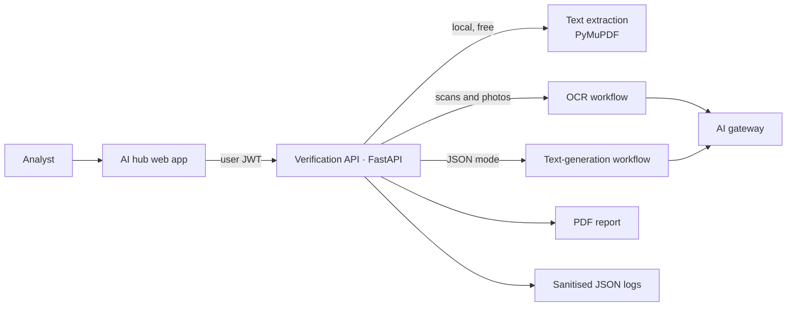

# Document Verification API

Checks registration-change and payee-registration requests against their supporting documents (IDs, proofs of address, bank letters, phone photos) and returns a structured, defensible opinion plus a PDF report.

**Stack:** Python · FastAPI · Pydantic · PyMuPDF · openpyxl · ReportLab · OAuth2 / JWT · pytest (449 tests)
**Role:** Lead developer: design and implementation
**Status:** Validated with real document batches

> Built at a large Brazilian insurer. The company is replaced by the fictional **Acme Seguros**, and every name, document and data point here is fictional. Code, prompts and UI are in Portuguese, written for Brazilian business teams.

## Problem

Operations analysts checked every field of a request by hand against IDs, proofs of address, bank letters and photos taken sideways on a phone. Some had started pasting documents into a general chat tool, which was neither auditable nor safe for personal data under Brazil's data protection law (LGPD).

## What I built



- **Batch validation** by count, size and real file type (magic bytes, not the extension).
- **Cost control:** digital PDFs are read locally for free; only scans and photos go to OCR, up to 4 in parallel within a time budget.
- **Structured decision:** each field is Validated, Divergent, Not found or Not applicable, with evidence; the overall decision is Fit, Fit with caveats, Unfit or Inconclusive.
- **Counts and ratings computed in code**, not by the model; off-schema model output is rejected.
- **8-section PDF report** generated from the JSON result.
- **LGPD-safe logging:** personal data and credentials are redacted.

Full write-up with trade-offs: [docs/CASE_STUDY.md](docs/CASE_STUDY.md) · architecture notes in [docs/](docs/)

## Run it

```bash
python -m venv .venv && .venv\Scripts\activate   # macOS/Linux: source .venv/bin/activate
pip install -r requirements.txt
pytest                                             # 449 tests, no keys needed
cp .env.example .env                               # gateway URL + Entra ID app
uvicorn src.main:app --reload                      # Swagger at /docs
```

---
Part of my [AI engineering portfolio](https://github.com/lucasboliveirasipp).
