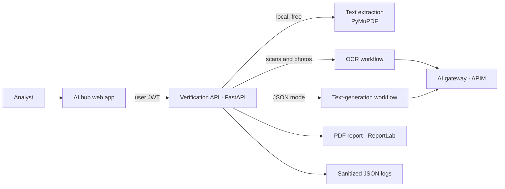

# Document Verification API — case study

A FastAPI service that checks insurance registration requests against their supporting documents and returns a structured, auditable opinion plus a PDF report.

> Built at a large Brazilian insurer. Names, documents and data are fictional.

## Context

Operations analysts received batches of documents for two kinds of request: **registration changes** (a policyholder changes name, address or bank details) and **assignee registration** (people or companies registered to receive payments). They checked every field by hand, comparing a spreadsheet with ID cards, proofs of address, bank letters and phone photos. Some analysts had started pasting documents into a general chat tool, which was neither auditable nor safe for personal data under the LGPD.

## The problem

- Documents arrive as digital PDFs, scanned PDFs and phone photos taken sideways.
- Each field must be marked **Validated**, **Divergent**, **Not found** or **Not applicable**, with evidence.
- The output has to be a decision an analyst can defend (Fit, Fit with caveats, Unfit, Inconclusive), not a chat answer.
- Every AI call must go through the company's governed AI gateway. No direct calls to model providers.

## What I built

A dedicated backend that sits between the company's AI hub front end and the AI gateway:



**Request flow for a registration change**
1. Validate the batch: count, size and real file type (magic bytes, not the extension).
2. Extract text from digital PDFs locally, at no AI cost.
3. Send only scans and photos to the gateway's OCR workflow: photos become PDFs (respecting the phone's rotation), up to 4 in parallel, inside a time budget. Digital annotations pasted over a scan are kept together with the OCR text.
4. Call the text-generation workflow with `response_format=json_object` and today's date in the prompt.
5. Validate the answer with Pydantic and return `{decision, summary, documents, validations, attention points, conclusion}`.
6. A second endpoint turns that JSON into an 8-section PDF report.

**Assignee registration** adds a spreadsheet step: openpyxl finds the header row by column name, extracts 16 fields for up to 5 people per analysis, and the model compares each field with the documents. The summary counts and the legibility rating are computed by the API, not by the model.

## Key decisions and trade-offs

| Decision | Why | Trade-off |
|---|---|---|
| **Gateway-only AI**, enforced by a test that fails if any direct provider SDK is imported | Governance and auditability were non-negotiable | Development depends on the gateway's workflow contracts; I built neutral "ports" so the service could be finished and tested before they existed |
| **JSON is the source of truth**, the PDF is derived from it | Totals and tables never depend on free text from the model | Two endpoints instead of one, and a strict schema to maintain |
| **Local extraction first, OCR only when needed** | Most PDFs are digital, so OCR cost and latency drop sharply | Mixed documents (digital page with a scanned stamp) need a merge step |
| **Fail closed** | Missing config, unknown external state or an off-schema answer never becomes "completed" | More 502/503 responses during gateway incidents, by design |
| **Sanitized logging** (CPF, CNPJ, JWTs, signed URLs and bearer tokens redacted automatically) | LGPD: personal data must not leak into logs | Debugging needs correlation IDs instead of raw payloads |

## Quality

- **449 automated tests**, all offline: every gateway call, OCR result and PDF is simulated.
- Fake PDFs generated in tests: encrypted, broken, image-only and mixed text+image files.
- Typed errors mapped to HTTP status codes; technical detail only in the JSON log.

## Illustrative snippet

```python
class FieldCheck(BaseModel):
    field: str
    status: Literal["Validated", "Divergent", "Not found", "Not applicable"]
    evidence: str | None = None          # document + page the value came from

class Opinion(BaseModel):
    decision: Literal["Fit", "Fit with caveats", "Unfit", "Inconclusive"]
    summary: str
    checks: list[FieldCheck]

def parse_opinion(raw: str) -> Opinion:
    # The model answers in JSON mode; anything off-schema is a 502, never a "success".
    try:
        return Opinion.model_validate_json(raw)
    except ValidationError as exc:
        raise GatewayInvalidResponse("off-schema opinion") from exc
```

## Stack

Python 3.11 · FastAPI · Pydantic v2 · PyMuPDF · openpyxl · ReportLab · requests · PyJWT · pytest · Azure API Management · Entra ID (client credentials)
